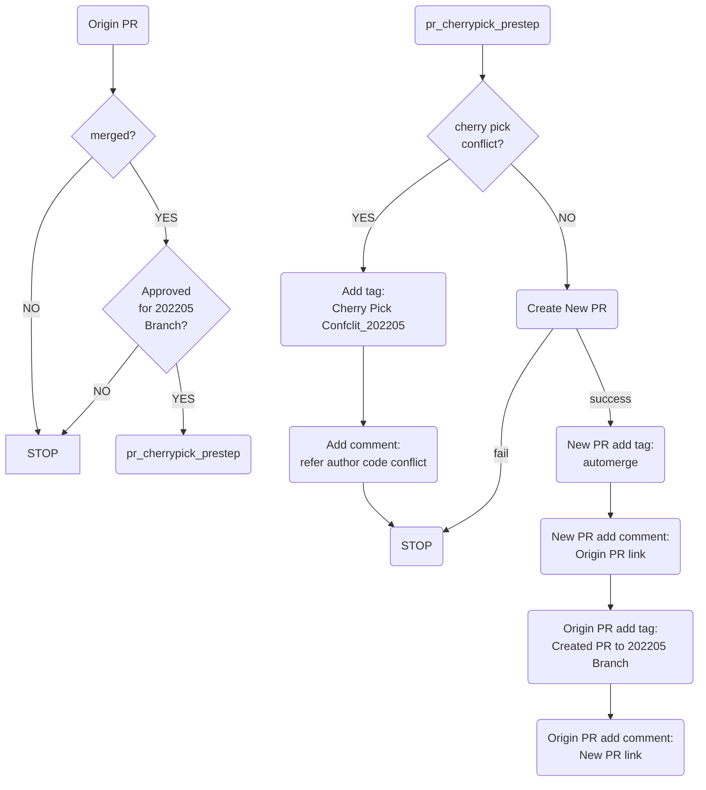
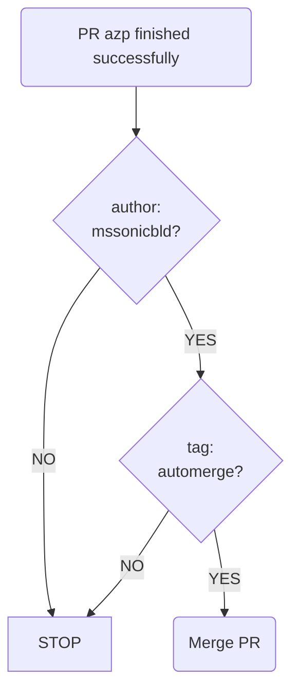
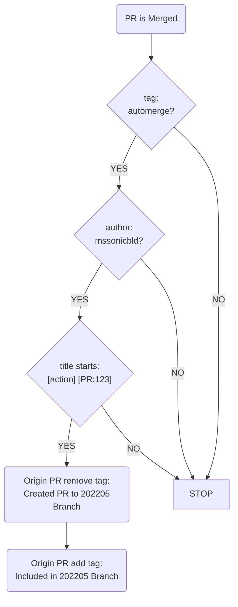

#  Github actions README
This is an introduction about auto-cherry-pick workflow.
take 202205 branch for example:
1. pr_cherrypick_prestep:

2. automerge:

3. pr_cherrypick_poststep:

## VS installer and OCI validation

`bazel-oci.yml` builds `target/sonic-vs.bin` and the runtime/debug Orchagent
and Syncd OCI archives. Its Make job retains SWSS and Syncd source-package
validation, P4 image tests, split-debug checks, and archive reuse evidence.
Installer assembly uses the same declared worker and ONIE/ZIP byte-chain
verifier as the unprivileged assembly workflow, retaining byte-chain, result,
and privilege evidence.
The job publishes an ONIE installer; it does not construct `sonic-vs.img.gz`
or run guest installation and boot checks.

Both this job and the unprivileged assembly workflow use the shared
`sonic-vs-bin` pool. Their preflight selects `--build-target sonic-vs.bin`,
so runners such as `lgh102` can build without `/dev/kvm`. Native preparation
uses the official container registry and Debian mirrors through existing
Make overrides; the existing version-control inputs still apply.

Both workflows first call `bazel-kernel-native.yml` to build the AMD64 VS/Trixie
kernel on Ubuntu 22.04 with the kernel launcher's enforced `linux-sandbox`.
The producer and native consumers check out the same `github.sha`. Each workflow
transfers its own `kernel-native-amd64` artifact: five verified kernel DEBs,
their package manifest, and source/configuration provenance. After recursive
checkout, the native job verifies and imports this handoff before running Make;
the ordinary kernel prerequisite verifies and reuses those packages. This keeps
the devbox host's AppArmor policy unchanged. Only Bazel's download and action
caches are eligible for reuse, and cache uploads are limited to 8 GiB.

## Unprivileged VS installer assembly

The self-hosted runner does not need host `sudo`. A short setup container uses
the exact worker image, individual mounts for the job's state/evidence paths,
and only `CHOWN`/`FOWNER` capabilities to prepare shared filesystem permissions.
It does not run Make or Bazel. The final build container then runs with all
capabilities dropped and no-new-privileges enabled. CI also disables Bazel's
workspace lockfile writes and convenience symlinks; the hosted source-download
job retains generated resolution evidence.

The hosted jobs fetch the reviewed GitLab, pigz and GNU tool source archives
listed in `tools/bazel/gzip/source_archive.py`. That manifest supplies the exact
repository selectors, upstream filenames and SHA256/SHA512 integrity values,
including the Bison and M4 repositories generated by their toolchain extensions.
Native Make receives distdir arguments generated from the verified set, and the
same source bytes travel in the final-assembly handoff. Both assembly workers
recheck every archive before use, so these downloads do not depend on a warm
runner repository cache or direct access to those upstream source hosts.

`bazel-vs-unprivileged.yml` validates the optional containerd-backed
`target/sonic-vs.bin` assembly path on AMD64. It preserves a job boundary between
native source production and final assembly:

1. A hosted check creates a content-only containerd store as UID/GID 1000 with
   all capabilities dropped, no new privileges, default seccomp and no Docker
   socket. A separate privileged container checks that the exact output still
   supports image unpacking and runtime filesystem behavior.
2. `Native Make prerequisites (AMD64)` uses the shared bin-only runner
   pool to run `bazel-vs-native-inputs`. It finalizes the host filesystem and
   exports the host receipt, service archives and their producer identities.
   Its assembly worker derives from the actual Trixie `sonic-slave` image;
   immutable image IDs and layer ancestry are recorded. This job retains
   privileged execution and does not produce the final installer.
3. `Unprivileged sonic-vs.bin assembly (AMD64)` downloads the same run's
   checksummed handoff into an independent checkout, imports that exact worker
   image, and runs the ordinary Make target **inside** its unprivileged
   `sonic-slave`-based container. The container runs as UID/GID 1000 with all
   capabilities dropped and no Docker socket. A fresh Bazel output root avoids
   reusing privileged final-assembly actions. CI records both Docker settings
   and the process's effective capabilities, seccomp and no-new-privileges state.
   It checks the full ONIE/ZIP byte chain before uploading `sonic-vs.bin`.

Native prerequisites and final assembly use separate GitHub jobs and exchange
an explicit artifact, so they do not depend on scheduling onto the same machine.
Both jobs use the shared `sonic-vs-bin` label for same-repository PR, push, and
manual runs. The native preflight selects `sonic-vs.bin`,
which does not require KVM because this workflow does not boot the installer.
The transfer includes the worker image and service archives and can be large;
its time is not a final-assembly speed measurement. The runtime test uses small
storage fixtures, while the full job uses native source-produced SONiC inputs.
Neither establishes guest boot or forwarding coverage.
