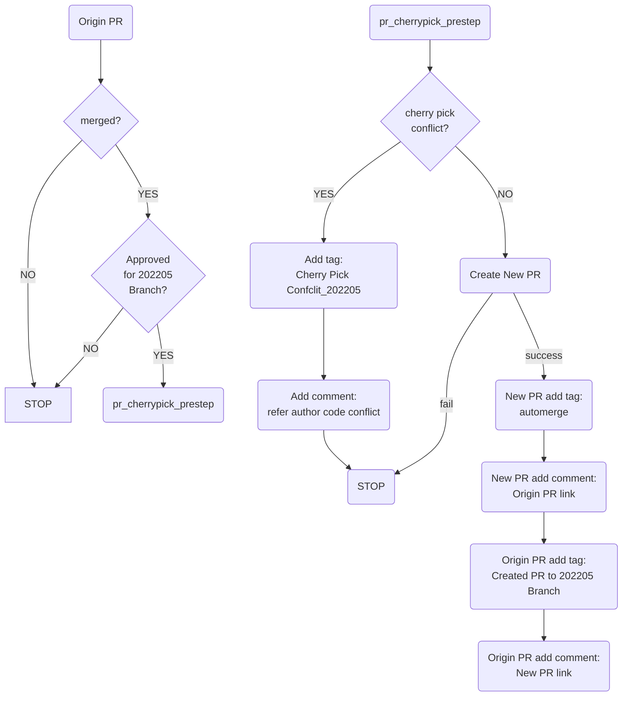
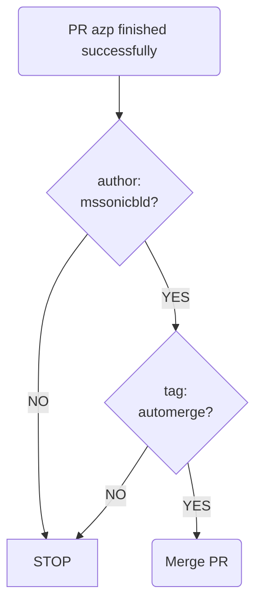
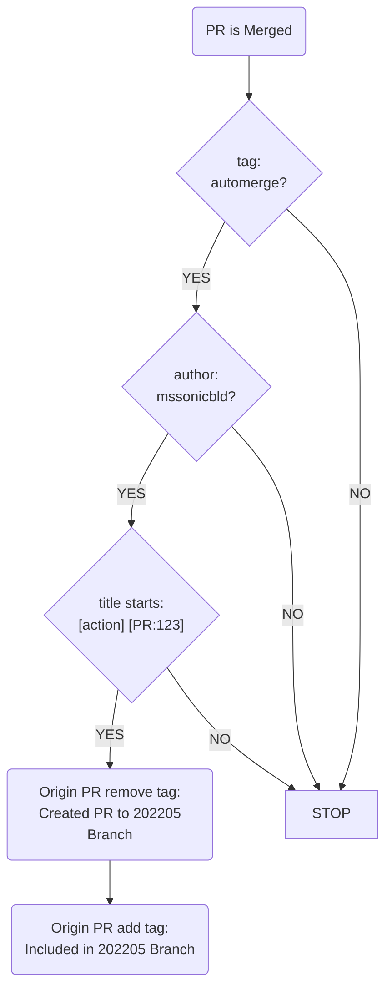

#  Github actions README
This is an introduction about auto-cherry-pick workflow.
take 202205 branch for example:
1. pr_cherrypick_prestep:

2. automerge:

3. pr_cherrypick_poststep:

## Reviewed Eventd source on AMD64

In `bazel-oci.yml`, select `source_image=eventd` and supply paired immutable
40-character `source_revision` and `registry_revision` commits. The catalog
input applies only to Eventd; other source-image selections keep their existing
interfaces. Leave `source_inputs_run` blank for Eventd.

The manual Eventd jobs use distinct check and artifact names. They check out the
selected source under `review-source` for its Eventd drivers. The controller
checkout retains checkout identity, the archive runner and cache namespace,
startup repair, mirrors, upload policy and public sanitization. Its review
launcher keeps selected checked-in build defaults, replaces the local downloader
default with the controller's verified mirrors, ignores the selected user RC,
and selects the immutable SONiC catalog plus BCR. Normal archive, installed
Eventd runtime and other-image jobs keep their existing execution paths.

The exact documented source/catalog pair retains the size- and SHA256-verified
libpcre2 prefetch. Only its controller-validated diagnostic receipt is public.
`reviewed-selection.json` binds source, catalog, controller checkout identity
and the loaded-driver hash before installed Redis and event-delivery checks.
