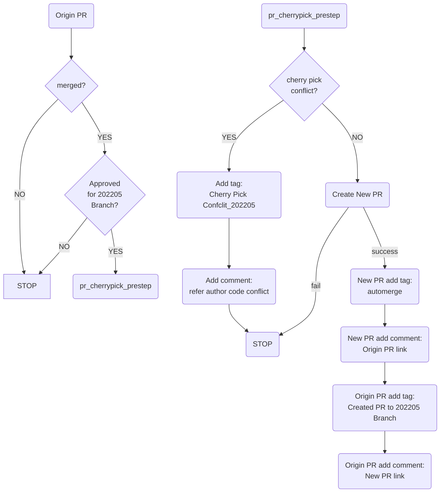
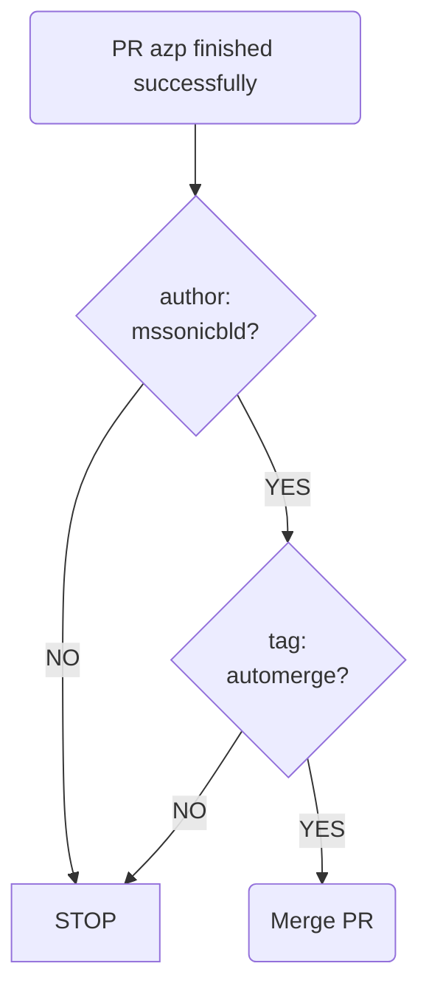
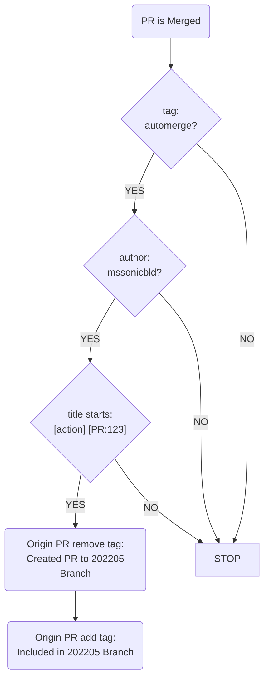

#  Github actions README
This is an introduction about auto-cherry-pick workflow.
take 202205 branch for example:
1. pr_cherrypick_prestep:

2. automerge:

3. pr_cherrypick_poststep:

## Reviewed sFlow source validation

The optional `sflow-hosted` manual mode in `bazel-oci.yml` requires paired full
source and registry commit SHAs. It selects AMD64 for the existing archive and
combined SWSS/sFlow installed job. Both check out the same source; the loaded
job verifies the native selection before loading the sFlow images and retains
the original SWSS source/hash checks. Blank/default mode retains the
existing owner graph and architecture matrix.

The reviewed mode preserves setup-bazel caches, adds a checksum-verified shared
downloader configuration, and reclaims only the three unused SDK mounts on a
disposable GitHub runner. It retains all original sFlow exports, source-owner
tests, static and incremental checks, plus the private Redis/veth, mapper,
polling and UDP exporter gates. It skips unrelated general checks and VS jobs. The exact owned review branch excludes the existing
DEB-generating kernel fixtures; remove that temporary exception before Ready.
This workflow does not establish independent clean-root reproducibility or final
VS installer acceptance.
