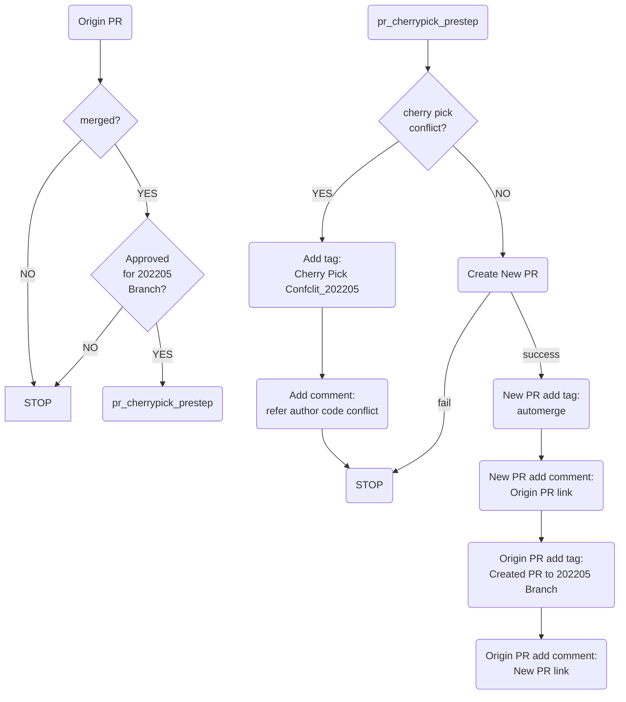
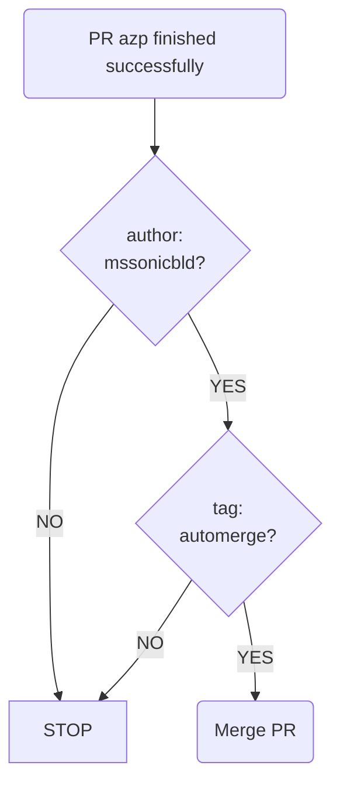
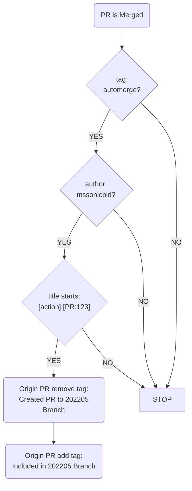

#  Github actions README
This is an introduction about auto-cherry-pick workflow.
take 202205 branch for example:
1. pr_cherrypick_prestep:

2. automerge:

3. pr_cherrypick_poststep:

## Unprivileged VS installer assembly

The self-hosted runner does not need host `sudo`. A short setup container uses
the exact worker image, individual mounts for the job's state/evidence paths,
and only `CHOWN`/`FOWNER` capabilities to prepare shared filesystem permissions.
It does not run Make or Bazel. The final build container then runs with all
capabilities dropped and no-new-privileges enabled. CI also disables Bazel's
workspace lockfile writes and convenience symlinks; the hosted source-download
job retains generated resolution evidence.

The hosted job fetches and verifies the five GitLab source archives already used
by the OCI workflow. Native Make receives their verified distdirs, and the same
source bytes travel in the final-assembly handoff. Both assembly workers recheck
the BCR SHA512 values before using them, so a cold build does not depend on an
existing runner repository cache or direct GitLab access.

`bazel-vs-unprivileged.yml` validates the optional containerd-backed
`target/sonic-vs.bin` assembly path on AMD64. It preserves a job boundary between
native source production and final assembly:

1. A hosted check creates a content-only containerd store as UID/GID 1000 with
   all capabilities dropped, no new privileges, default seccomp and no Docker
   socket. A separate privileged container checks that the exact output still
   supports image unpacking and runtime filesystem behavior.
2. `Native Make prerequisites (AMD64)` uses the existing source-build runner
   pool to run `bazel-vs-native-inputs`. It finalizes the host filesystem and
   exports the host receipt, service archives and their producer identities.
   Its assembly worker derives from the actual Trixie `sonic-slave` image;
   immutable image IDs and layer ancestry are recorded. This job retains
   privileged execution and does not produce the final installer.
3. `Unprivileged sonic-vs.bin assembly (AMD64)` downloads the same run's
   checksummed handoff into an independent checkout, imports that exact worker
   image, and runs the ordinary Make target **inside** its unprivileged
   `sonic-slave`-based container. The container runs as UID/GID 1000 with all
   capabilities dropped and no Docker socket. A fresh Bazel output root avoids
   reusing privileged final-assembly actions. CI records both Docker settings
   and the process's effective capabilities, seccomp and no-new-privileges state.
   It checks the full ONIE/ZIP byte chain before uploading `sonic-vs.bin`.

Native prerequisites and final assembly use separate GitHub jobs and exchange
an explicit artifact, so they do not depend on scheduling onto the same machine.
Both jobs use the shared `sonic-vs-bin` label for same-repository PR, push, and
manual runs. This bin-only pool is separate from the full-image pool that
requires KVM. The native preflight selects `sonic-vs.bin`,
which does not require KVM because this workflow does not boot the installer.
The transfer includes the worker image and service archives and can be large;
its time is not a final-assembly speed measurement. The runtime test uses small
storage fixtures, while the full job uses native source-produced SONiC inputs.
Neither establishes guest boot or forwarding coverage.
