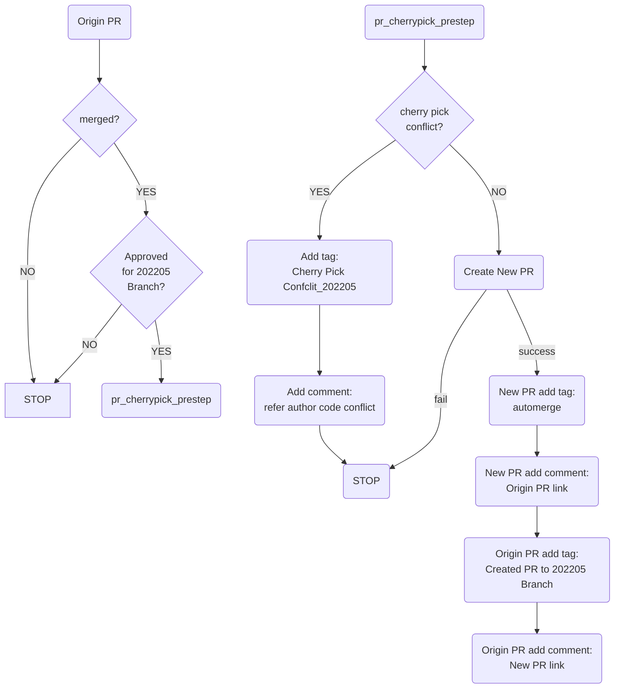
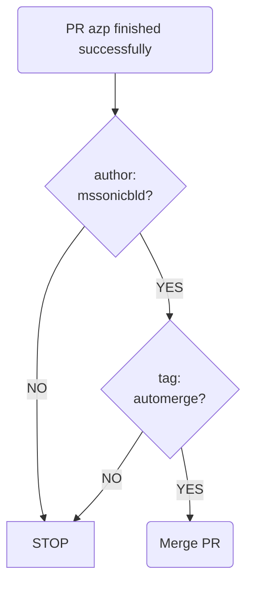
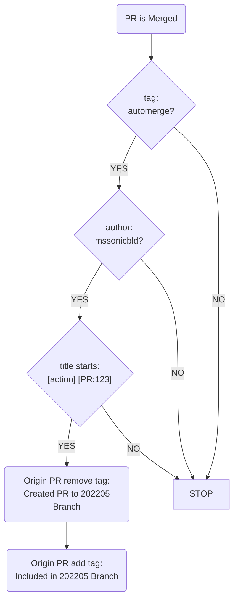

#  Github actions README
This is an introduction about auto-cherry-pick workflow.
take 202205 branch for example:
1. pr_cherrypick_prestep:

2. automerge:

3. pr_cherrypick_poststep:

# Reviewed Database source on hosted AMD64

The existing `bazel-oci.yml` workflow accepts `source_image=database-hosted`
with paired 40-character `source_revision` and `registry_revision` values.
This selects the original AMD64 archive, Database loaded-service and acceptance
jobs on GitHub-hosted runners. Both source checkouts use the selected commit;
the loaded job checks the retained source/catalog/controller receipt and exact
loaded-driver hash before running the original Redis and DASH checks.

The manual mode retains the original build, static validation and incremental
restoration gates, generated module lock/graph, source action audits and caches.
It uses the reviewed checksum-pinned source and Debian payload downloader
configuration. `none`, dedicated worker selections and ordinary PR matrices keep
their existing behavior. The exact owned control PR excludes kernel generation,
package-generating test fixtures and full VS execution; this is component image
validation, not installer acceptance.
