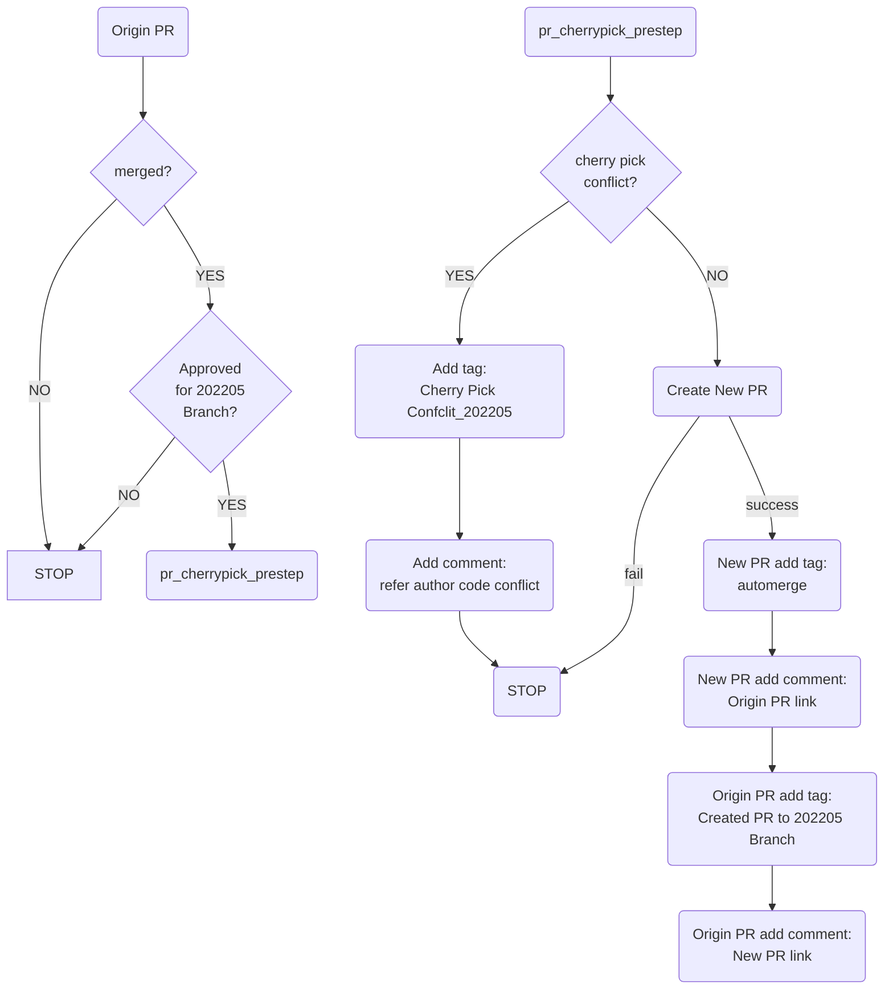
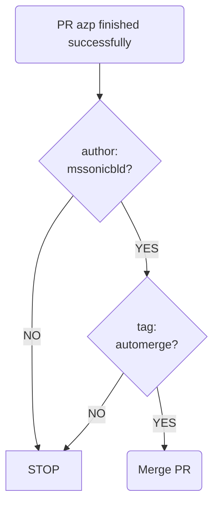
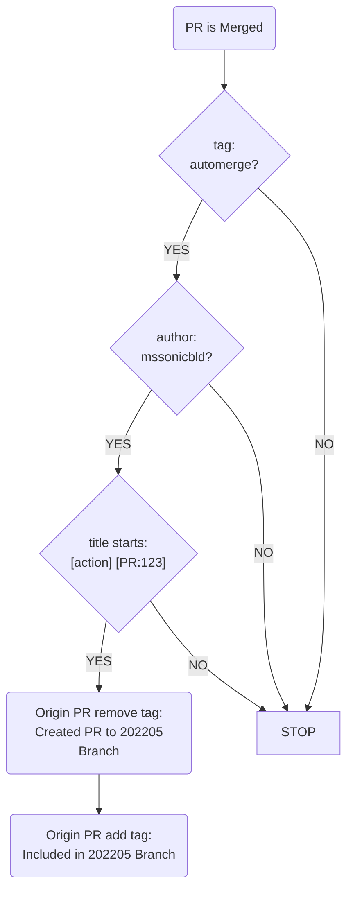

#  Github actions README
This is an introduction about auto-cherry-pick workflow.
take 202205 branch for example:
1. pr_cherrypick_prestep:

2. automerge:

3. pr_cherrypick_poststep:

## Reviewed Router Advertiser source on hosted AMD64

Run `bazel-oci.yml` with `source_image=radv` and paired `source_revision` and
`registry_revision` values to validate an immutable source and registry snapshot.
Both revisions must be 40-character commit IDs. The Radv jobs use hosted AMD64
for this selection; normal pull requests and `source_image=none` retain the
self-hosted native runner, workflow checkout, registry, cache and mirror behavior.
The native and loaded jobs use the same selected source. Loaded validation
checks the retained source/catalog/controller receipt and loaded-driver hash
before the private Redis, IPv6 router-advertisement and VLAN-readiness checks.

The selected source must provide `lldp_draft_cache.py`, executable
`review_bazel.sh` and its `review_bazel_rc.py` companion, `prepare_pigz.py`, and
the Radv build, loaded and Make-handoff entrypoints in their existing
`tools/bazel` locations. The workflow checks these entrypoints before building;
a source snapshot without this interface is not supported by this mode.

The reviewed selection retains the source/TAR action audit, static symbols and
configuration checks, template-edit restoration, generated lock/graph and public
artifacts. It uses the reviewed cache, checksum-pinned transport and disposable
hosted-runner space step without the self-hosted private-cache settings. Other
source-image worker choices and normal regression/installer checks are unchanged.
This is component image validation, not installer acceptance.
