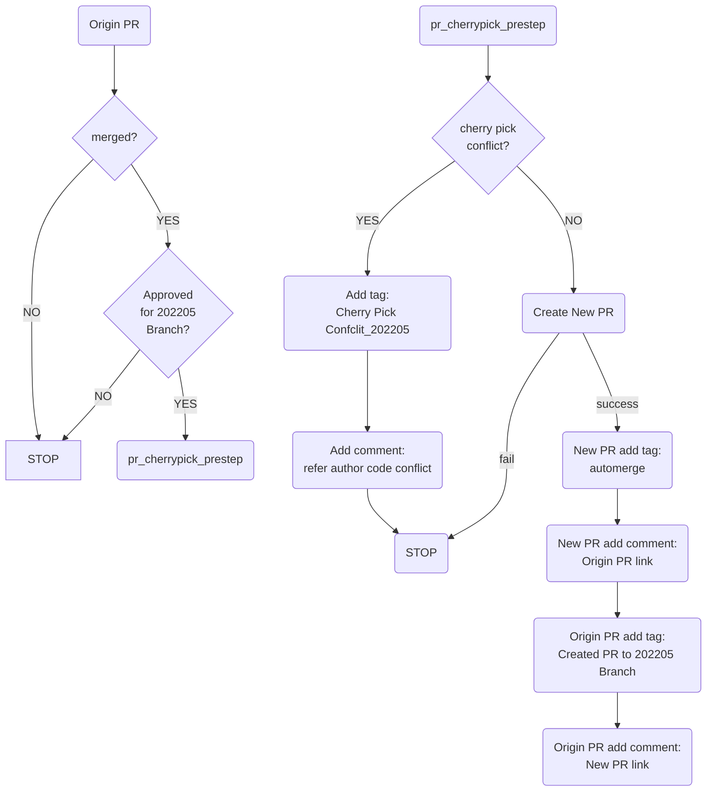
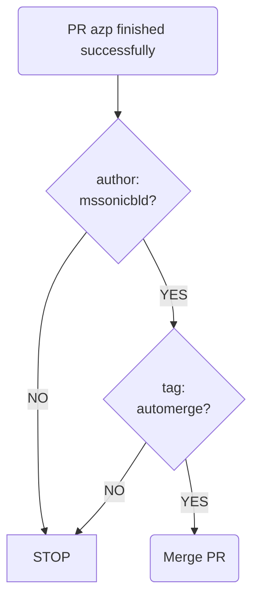
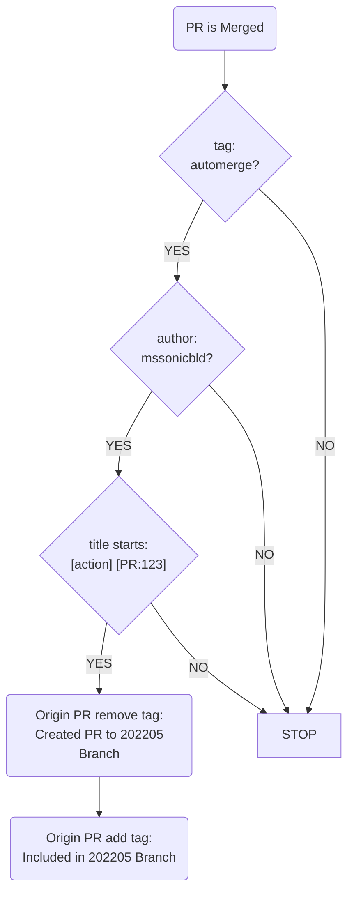

#  Github actions README
This is an introduction about auto-cherry-pick workflow.
take 202205 branch for example:
1. pr_cherrypick_prestep:

2. automerge:

3. pr_cherrypick_poststep:

## Reviewed Router Advertiser source on hosted AMD64

The existing `bazel-radv-image.yml` workflow accepts optional paired
`source_revision` and `registry_revision` values. Both must be immutable
40-character commit IDs. Blank inputs keep the original workflow checkout and
registry behavior. The native and loaded jobs use the same selected source;
loaded validation verifies the retained source/catalog/controller receipt and
loaded-driver hash before the original private Redis, IPv6 router-advertisement and VLAN-readiness checks.

The manual selection retains the original source/TAR action audit, static
symbols/configuration checks, template-edit restoration, generated lock/graph
and public artifacts. It reuses the reviewed cache, checksum-pinned transport
and disposable hosted-runner space step. The exact control PR excludes
package-generating fixtures and full VS execution; the original PR6 kernel gate
is unchanged. This is component image validation, not installer acceptance.
