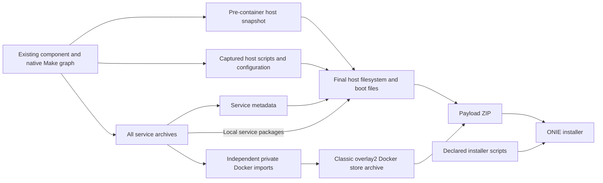

# VS installer assembly

`//tools/bazel/image/vs:sonic-vs.bin` assembles an unsigned SONiC VS ONIE
installer for AMD64 Debian Trixie. Its inputs are a native host snapshot,
rendered host configuration, installer scripts, and **every installed and local
service archive**.
The existing Make and Bazel component producers continue to build those
archives. Orchagent uses the same archive boundary as every other service.

The public selector remains `BUILD_WITH_BAZEL_WHEN_AVAILABLE`. With `y`,
`make target/sonic-vs.bin` assembles already prepared inputs through Bazel and
publishes the installer atomically. With `n`, it uses the native Make installer
path. The default, component selection rules, and KVM image target are unchanged.

Final Bazel assembly is selected by the top-level Make command. A direct
`make -f slave.mk target/sonic-vs.bin BUILD_WITH_BAZEL_WHEN_AVAILABLE=y` request
keeps native installer assembly while using the configured component producers.
It rejects a retained installer published by Bazel; use the top-level publisher
to switch that installer back to the native producer.

The native VS ONIE and KVM paths use the same publication transaction. A KVM build
holds its lock while generating and consuming `target/sonic-vs.bin`; success
clears the Bazel producer receipt, and an ordinary failure restores the previous
Bazel installer and receipt. The transaction creates
`target/.sonic-vs.bin.native-in-progress` before starting a native writer.
An interruption retains that marker and any backup, so later publishers stop
until remaining workers have stopped, the previous installer has been restored
when a backup exists, and the marker has been removed. With no backup, treat
the installer and its receipt as unverified: inspect them and move incomplete
output or an obsolete receipt aside before rebuilding. Remove the marker only
after that recovery is complete. Component producer selection is unchanged.

## Declared inputs and execution

Start with an initialized recursive checkout and the normal native build
prerequisites. Run the existing outer Make commands so its distribution phases
and component producer selection remain in effect:

```sh
make init
make configure PLATFORM=vs PLATFORM_ARCH=amd64
make BUILD_WITH_BAZEL_WHEN_AVAILABLE=y \
  ENABLE_SBOM=n SONIC_ENABLE_IMAGE_SIGNATURE=n SECURE_UPGRADE_MODE=no_sign \
  ENABLE_ASAN=n SONIC_INSTALL_DEBUG_TOOLS=n INSTALL_DEBUG_TOOLS=n \
  bazel-vs-native-inputs
```

The last command must run by itself. It builds the normal installer
prerequisites, including all installed and local service archives, and captures the host immediately
before container loading. It writes `target/bazel-native/provenance.json`, the
snapshot, rendered host inputs, and the evaluated image inventory. It does not
publish a finished installer. `target/bazel-native` must be absent before a new
capture; existing inputs are never silently adopted or overwritten.

The capture supports native AMD64 Trixie VS ONIE with unsigned, non-ASAN,
non-debug configuration. Multi-ASIC KVM, cross builds, reduced-size images,
Kubernetes, remote service packages, custom organization hooks, installer
post-build hooks, and SBOM generation are outside this assembly path. Leave
those features disabled and use `SECURE_UPGRADE_MODE=no_sign`.
The final Make command also rejects unsupported feature options before publishing
the prepared image.

Capture records `INCLUDE_FIPS`, `ENABLE_FIPS`, and the resolved extra kernel
command line. Pass the same options to the final top-level Make request; a
mismatch fails before Bazel starts. Supported examples are:

| Capture and final request options | Installer kernel arguments |
| --- | --- |
| `INCLUDE_FIPS=y ENABLE_FIPS=y` with no extra command line | `sonic_fips=1` |
| `ENABLE_FIPS=n 'EXTRA_CMDLINE_LINUX="console=ttyS0,115200n8 quiet"'` | `console=ttyS0,115200n8 quiet` |

`EXTRA_CMDLINE_LINUX` must be one literal shell value; quote spaces as shown.
Shell expansion/operator syntax, backslash escapes, and unquoted multiple words
are rejected. A nonempty extra command line combined with `ENABLE_FIPS=y` is also rejected:
the existing native substitution renders `sonic_fips=1` as a separate shell
assignment for that form. The native installer script is unchanged. Existing
native rejection of `INCLUDE_FIPS=n ENABLE_FIPS=y` is preserved.

Build the [execution worker](worker/README.md) and write its explicit immutable
identity to `target/bazel-image-worker.json`. Then freeze the producer outputs:

```sh
python3 tools/bazel/image/prepare_inputs.py \
  --native-directory target/bazel-native \
  --installer-source "$PWD" \
  --execution-environment target/bazel-image-worker.json \
  --output target/bazel-image-inputs

make BUILD_WITH_BAZEL_WHEN_AVAILABLE=y \
  ENABLE_SBOM=n SONIC_ENABLE_IMAGE_SIGNATURE=n SECURE_UPGRADE_MODE=no_sign \
  ENABLE_ASAN=n SONIC_INSTALL_DEBUG_TOOLS=n INSTALL_DEBUG_TOOLS=n \
  target/sonic-vs.bin
```

Preparation requires the producer receipt, matching live producer source
identity, matching configuration, and the size/SHA256 of every declared file.
It rejects missing or extra service archives, source-target substitutions,
linked inputs, and an unsupported worker. It copies all archives into the input
bundle and creates the optional VS Bazel package only after preparation succeeds.
The input output directory must be fresh. Historical bundles without the required
producer evidence cannot enter this production path.

The preparation receipt also binds the generated Bazel input definitions and
the active VS BUILD file. The public build retains verified, read-only copies of
the receipt and graph controls under `target/bazel-image-graphs/<receipt-sha256>/workspace`
and makes Bazel load those two generated packages from that snapshot. A declared
verification action checks the complete staged file inventory and each
size/SHA256 while copying the payload files into outputs owned by Bazel.
Assembly actions consume those verified copies, with each file exposed
separately so downstream actions keep their specific input sets. The public
entry verifies the retained graph and checks the copied receipt from that Bazel
execution before publishing.
Old partial captures and bundles that lack these records are retained but cannot
be resumed; start a fresh capture and preparation in the required fresh directories.

The prepared bundle records two identities separately:

- `native_source_identity` and `native_config_flags` identify the snapshot and
  service archive producer, including its requested build selector, image
  version, and epoch.
- `assembler_source_identity` identifies `--installer-source`; its installer
  scripts, configuration, and generated manifests are frozen with per-file
  hashes. Source identity and source-file hashes are rechecked after staging.
  A newer assembler does
  not relabel an older producer's snapshot or image version.

The public build command consumes this prepared bundle; it does not run native
production or regenerate inputs automatically. The build's successful Bazel
events identify the final output and its digest before publication to
`target/sonic-vs.bin`, with executable mode `0755`. A failed replacement leaves
the previous published installer intact. Switching back to native Make forces
a native rebuild when the retained installer came from Bazel.

## Assembly and cache boundaries



The host action depends on builtin service metadata and the captured host
configuration. Local service packages are full host inputs because installation
can copy files into the host. Each service archive has a separate import action
using a fresh private Docker daemon. Store assembly deduplicates shared layers
and reuses compressed layer fragments. Host finalization, store assembly, ZIP
creation, and ONIE wrapping have separate Bazel action boundaries.

The current store format is Docker 28.5.2 classic `overlay2`. Worker identity is
an explicit action input. Host finalization and Docker import require local
privileged execution; neither consumes the host Docker socket. Filesystem
metadata that cannot be preserved by the store collector fails explicitly.

The public build retains a verified worker specification and graph snapshot
before launching Bazel. For direct investigation or repeated requests using
the same bundle, derive those retained paths from its receipt:

```bash
receipt="$PWD/target/bazel-image-inputs/provenance.json"
receipt_sha=$(sha256sum "$receipt")
receipt_sha=${receipt_sha%% *}
worker_sha=$(python3 - "$receipt" <<'PY'
import json
from pathlib import Path
import sys
print(json.loads(Path(sys.argv[1]).read_text())["files"]["execution-environment.json"]["sha256"])
PY
)
worker_spec="$PWD/target/bazel-image-worker-specs/$worker_sha.json"
graph_root="$PWD/target/bazel-image-graphs/$receipt_sha/workspace"
test -f "$worker_spec"
test -d "$graph_root"

python3 tools/bazel/image/run.py \
  --workspace "$PWD" --mount-root "$PWD" \
  --worker-spec "$worker_spec" \
  --output-user-root "$PWD/target/bazel-image-state" \
  --persistent-worker sonic-vs-assembly \
  -- build "--package_path=$graph_root:%workspace%" \
  //tools/bazel/image/vs:sonic-vs.bin
```

An optional `--repository-cache /absolute/cache/path` shares repository
downloads. The named worker retains its Bazel server and output state. Use the
same arguments with `--worker-action stop` and omit the trailing Bazel command
to stop it. A worker started with the former raw specification path must first
be stopped with its original arguments before its name is reused with the
verified path. Direct Bazel requests produce Bazel outputs; run the public Make
command to revalidate the bundle and publish `target/sonic-vs.bin`.

### SWSS example: snapshot to finalized host

The retained AMD64 VS build showed these host filesystem changes:

| Host file | Prepared snapshot | Finalized host |
| --- | --- | --- |
| `/usr/lib/systemd/system/swss.service` | Absent | Unit calling `/usr/local/bin/swss.sh` to start, wait and stop |
| `/usr/bin/swss.sh` | Absent | Docker control script using `docker-orchagent:latest` |
| `/usr/local/bin/swss.sh` | Absent | SWSS lifecycle and dependent-service handling |
| `/var/lib/sonic-package-manager/packages.json` | Absent | Registers `swss` with repository `docker-orchagent` |
| `/etc/sonic/warm-reboot_order` | Absent | Shutdown order placing `swss` before `syncd` |
| `/usr/bin/swssloglevel` | Native executable | Wrapper running `docker exec ... swssloglevel` |

The [finalization template](../../../files/build_templates/sonic_debian_extension.j2#L1186)
installs the units and scripts from declared sources; image manifests determine
shutdown order. The host `libswsscommon` library was already present and unchanged.

## Validation scope

The existing OCI archive CI job runs the focused assembly, input handoff,
source identity, input verification, worker lifecycle, publication, and archive tests
on AMD64 and ARM64 runners. These are Python/Make/Git fixtures; ARM64 execution does not imply
ARM64 installer support. The ONIE tests exercise payload checksums and shell
extraction with synthetic payloads.

This CI coverage does not perform a complete native-producer-to-ONIE build,
boot the installer, or validate forwarding. The existing component tests and
native KVM build retain their own coverage. Real assembly validation must retain
its producer and assembler identities, input hashes, worker identity, and output
evidence separately from any future guest-boot results.
