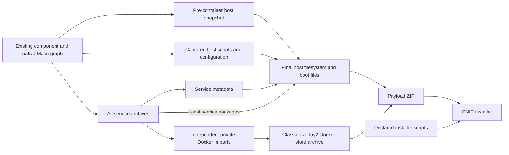

# VS installer assembly

`//tools/bazel/image/vs:sonic-vs.bin` assembles an unsigned SONiC VS ONIE
installer for AMD64 Debian Trixie. Its inputs are a native host snapshot,
rendered host configuration, installer scripts, and **every installed and local
service archive**.
The existing Make and Bazel component producers continue to build those
archives. Orchagent uses the same archive boundary as every other service.

The public selector remains `BUILD_WITH_BAZEL_WHEN_AVAILABLE`. With `y`,
`make target/sonic-vs.bin` assembles already prepared inputs through Bazel and
publishes the installer atomically. With `n`, it uses the native Make installer
path. The default, component selection rules, and KVM image target are unchanged.

## Declared inputs and execution

Start with an initialized recursive checkout and the normal native build
prerequisites. Run the existing outer Make commands so its distribution phases
and component producer selection remain in effect:

```sh
make init
make configure PLATFORM=vs PLATFORM_ARCH=amd64
make BUILD_WITH_BAZEL_WHEN_AVAILABLE=y \
  ENABLE_SBOM=n SONIC_ENABLE_IMAGE_SIGNATURE=n SECURE_UPGRADE_MODE=no_sign \
  ENABLE_ASAN=n SONIC_INSTALL_DEBUG_TOOLS=n INSTALL_DEBUG_TOOLS=n \
  bazel-vs-native-inputs
```

The last command must run by itself. It builds the normal installer
prerequisites, including all installed and local service archives, and captures the host immediately
before container loading. It writes `target/bazel-native/provenance.json`, the
snapshot, rendered host inputs, and the evaluated image inventory. It does not
publish a finished installer. `target/bazel-native` must be absent before a new
capture; existing inputs are never silently adopted or overwritten.

The capture supports native AMD64 Trixie VS ONIE with unsigned, non-ASAN,
non-debug configuration. Multi-ASIC KVM, cross builds, reduced-size images,
Kubernetes, remote service packages, custom organization hooks, installer
post-build hooks, and SBOM generation are outside this assembly path. Leave
those features disabled and use `SECURE_UPGRADE_MODE=no_sign`.
The final Make command also rejects unsupported feature options before publishing
the prepared image.

Build the [execution worker](worker/README.md) and write its explicit immutable
identity to `target/bazel-image-worker.json`. Then freeze the producer outputs:

```sh
python3 tools/bazel/image/prepare_inputs.py \
  --native-directory target/bazel-native \
  --installer-source "$PWD" \
  --execution-environment target/bazel-image-worker.json \
  --output target/bazel-image-inputs

make BUILD_WITH_BAZEL_WHEN_AVAILABLE=y \
  ENABLE_SBOM=n SONIC_ENABLE_IMAGE_SIGNATURE=n SECURE_UPGRADE_MODE=no_sign \
  ENABLE_ASAN=n SONIC_INSTALL_DEBUG_TOOLS=n INSTALL_DEBUG_TOOLS=n \
  target/sonic-vs.bin
```

Preparation requires the producer receipt, matching live producer source
identity, matching configuration, and the size/SHA256 of every declared file.
It rejects missing or extra service archives, source-target substitutions,
linked inputs, and an unsupported worker. It copies all archives into the input
bundle and creates the optional VS Bazel package only after preparation succeeds.
The input output directory must be fresh. Historical bundles without the required
producer evidence cannot enter this production path.

The prepared bundle records two identities separately:

- `native_source_identity` and `native_config_flags` identify the snapshot and
  service archive producer, including its requested build selector, image
  version, and epoch.
- `assembler_source_identity` identifies `--installer-source`; its installer
  scripts, configuration, and generated manifests are frozen with per-file
  hashes. Source identity and source-file hashes are rechecked after staging.
  A newer assembler does
  not relabel an older producer's snapshot or image version.

The public build command consumes this prepared bundle; it does not run native
production or regenerate inputs automatically. The build's successful Bazel
events identify the final output and its digest before publication to
`target/sonic-vs.bin`, with executable mode `0755`. A failed replacement leaves
the previous published installer intact. Switching back to native Make forces
a native rebuild when the retained installer came from Bazel.

## Assembly and cache boundaries



The host action depends on builtin service metadata and the captured host
configuration. Local service packages are full host inputs because installation
can copy files into the host. Each service archive has a separate import action
using a fresh private Docker daemon. Store assembly deduplicates shared layers
and reuses compressed layer fragments. Host finalization, store assembly, ZIP
creation, and ONIE wrapping have separate Bazel action boundaries.

The current store format is Docker 28.5.2 classic `overlay2`. Worker identity is
an explicit action input. Host finalization and Docker import require local
privileged execution; neither consumes the host Docker socket. Filesystem
metadata that cannot be preserved by the store collector fails explicitly.

For direct investigation or repeated Bazel requests, use the launcher:

```sh
python3 tools/bazel/image/run.py \
  --workspace "$PWD" --mount-root "$PWD" \
  --worker-spec "$PWD/target/bazel-image-inputs/execution-environment.json" \
  --output-user-root "$PWD/target/bazel-image-state" \
  --persistent-worker sonic-vs-assembly \
  -- build //tools/bazel/image/vs:sonic-vs.bin
```

An optional `--repository-cache /absolute/cache/path` shares repository
downloads. The named worker retains its Bazel server and output state. Use the
same arguments with `--worker-action stop` and omit the trailing Bazel command
to stop it. Direct Bazel requests produce Bazel outputs; the public Make command
owns publication to `target/sonic-vs.bin`.

### SWSS example: snapshot to finalized host

The retained AMD64 VS build showed these host filesystem changes:

| Host file | Prepared snapshot | Finalized host |
| --- | --- | --- |
| `/usr/lib/systemd/system/swss.service` | Absent | Unit calling `/usr/local/bin/swss.sh` to start, wait and stop |
| `/usr/bin/swss.sh` | Absent | Docker control script using `docker-orchagent:latest` |
| `/usr/local/bin/swss.sh` | Absent | SWSS lifecycle and dependent-service handling |
| `/var/lib/sonic-package-manager/packages.json` | Absent | Registers `swss` with repository `docker-orchagent` |
| `/etc/sonic/warm-reboot_order` | Absent | Shutdown order placing `swss` before `syncd` |
| `/usr/bin/swssloglevel` | Native executable | Wrapper running `docker exec ... swssloglevel` |

The [finalization template](../../../files/build_templates/sonic_debian_extension.j2#L1186)
installs the units and scripts from declared sources; image manifests determine
shutdown order. The host `libswsscommon` library was already present and unchanged.

## Validation scope

The existing OCI archive CI job runs the focused assembly, input handoff,
source-identity, worker-lifecycle, publication, and archive tests on AMD64 and
ARM64 runners. These are Python/Make/Git fixtures; ARM64 execution does not imply
ARM64 installer support. The ONIE tests exercise payload checksums and shell
extraction with synthetic payloads.

This CI coverage does not perform a complete native-producer-to-ONIE build,
boot the installer, or validate forwarding. The existing component tests and
native KVM build retain their own coverage. Real assembly validation must retain
its producer and assembler identities, input hashes, worker identity, and output
evidence separately from any future guest-boot results.
